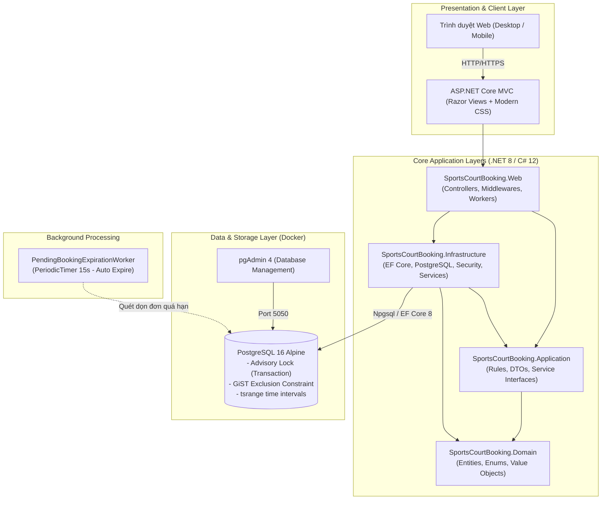

# Báo cáo Công nghệ Sử dụng (Tech Stack Specification)
### Dự án: Hệ thống Đặt sân Thể thao Trực tuyến (Sân Nhà)

> **Học phần:** Ngôn ngữ lập trình C#  
> **Giảng viên hướng dẫn:** TS. Đỗ Như Tài  
> **Nhóm thực hiện:** Nhóm 9  
> • 3124411038 - Trần Lê Gia Bảo  
> • 3124411245 - Huỳnh Nhật Quang  
> • 3124411337 - Nguyễn Thanh Tuấn  
> • 3124411261 - Đào Hữu Tài  
> • 3124411198 - Tô Thành Nhân  

---

## 1. Sơ đồ Kiến trúc Tổng thể (System Architecture)

Dự án áp dụng mô hình **Modular Monolith** kết hợp nguyên lý **Clean Architecture / N-Tier Architecture** nhằm phân định trách nhiệm rõ ràng (Separation of Concerns), giảm độ phụ thuộc (Loose Coupling) và dễ dàng bảo trì, mở rộng.



---

## 2. Bảng Tổng hợp Công nghệ (Tech Stack Matrix)

| Phân tầng / Khía cạnh | Công nghệ sử dụng | Phiên bản | Vai trò & Mục đích trong dự án |
| :--- | :--- | :--- | :--- |
| **Nền tảng & Ngôn ngữ** | **C# / .NET** | **C# 12 / .NET 8 (LTS)** | Nền tảng thực thi chính, hiệu năng cao, kiểu dữ liệu mạnh mẽ (`DateOnly`, `TimeOnly`, pattern matching, primary constructors). |
| **Giao diện & Web App** | **ASP.NET Core MVC** | 8.0 | Xây dựng ứng dụng web server-rendered với mô hình Model-View-Controller, Razor Engine, Tag Helpers. |
| **Giao diện Client** | **HTML5, CSS3, Vanilla JS** | Standard | Giao diện hiện đại, responsive thích ứng mobile, component card trực quan, không phụ thuộc nặng vào thư viện ngoài. |
| **Hệ quản trị CSDL** | **PostgreSQL** | 16 (Alpine) | CSDL quan hệ chính thức, lưu trữ người dùng, sân, đơn đặt; hỗ trợ kiểu dữ liệu dải (`tsrange`) và chỉ mục GiST. |
| **ORM & Data Access** | **Entity Framework Core** | 8.0.11 | Ánh xạ đối tượng C# sang bảng CSDL (Code-First), quản lý truy vấn qua LINQ, tối ưu `ExecuteUpdateAsync`. |
| **Database Driver** | **Npgsql.EntityFrameworkCore.PostgreSQL** | 8.0.11 | Provider chuyên dụng kết nối EF Core với PostgreSQL, hỗ trợ tính năng đặc thù của Postgres. |
| **Kiểm soát đồng thời** | **PostgreSQL Advisory Lock & GiST** | Built-in | Chống race condition (đặt trùng sân) ở cả tầng Transaction (`pg_advisory_xact_lock`) và tầng Schema (`EXCLUDE USING gist`). |
| **Tác vụ chạy ngầm** | **Hosted Service (`BackgroundService`)** | .NET 8 Built-in | Tác vụ `PendingBookingExpirationWorker` chạy ngầm định kỳ 15s để tự động giải phóng đơn `Pending` quá hạn 10 phút. |
| **Bảo mật & Xác thực** | **Cookie Authentication** | ASP.NET Core Built-in | Quản lý phiên làm việc bằng Cookie được mã hóa (`SanNha.Auth`), hỗ trợ bảo vệ dữ liệu bằng Data Protection keys. |
| **Băm mật khẩu** | **PBKDF2-HMAC-SHA256** | Custom Implementation | Thuật toán băm mật khẩu chuẩn NIST/OWASP với Salt ngẫu nhiên 128-bit và 100.000 vòng lặp. |
| **Phân quyền người dùng** | **Role-Based Access Control (RBAC)** | Claims-based | Phân định quyền hạn chặt chẽ theo vai trò (`Admin`, `Staff`, `Customer`) qua thuộc tính `[Authorize(Roles = "...")]`. |
| **Kiểm thử tự động** | **xUnit & Test SDK** | xUnit 2.5.3 | 49 unit tests tập trung vào quy tắc đặt sân, tính giá và băm mật khẩu; hiện chưa có kiểm thử tích hợp PostgreSQL. |
| **Đóng gói & Vận hành** | **Docker & Docker Compose** | Engine v24+ | Đóng gói toàn bộ hệ thống gồm 3 containers (`web`, `db`, `pgadmin`), khởi tạo môi trường nhất quán chỉ bằng 1 câu lệnh. |

---

## 3. Chi tiết Các Giải pháp Kỹ thuật Nổi bật (Engineering Highlights)

### 3.1. Chống Race Condition & Đặt Trùng Sân (Concurrency Control)
Bài toán phức tạp nhất của hệ thống đặt sân là khi hai hoặc nhiều người dùng cùng bấm nút đặt một sân trong cùng một khung giờ tại cùng một thời điểm. Hệ thống triển khai chiến lược **phòng vệ 2 lớp (Two-Layer Defense)**:

1. **Lớp 1: Pessimistic Lock ở mức Transaction (PostgreSQL Advisory Lock)**
   - Trước khi kiểm tra tình trạng trống và ghi đơn mới, hệ thống kích hoạt khóa:
     ```sql
     SELECT pg_advisory_xact_lock(hashtext('booking:{courtId}:{date}'));
     ```
   - Khóa có phạm vi giao dịch (`xact`), tự động giải phóng khi transaction kết thúc (Commit hoặc Rollback).
   - Đặt `SET LOCAL lock_timeout = '10s'` tránh tình trạng treo kết nối (deadlock).

2. **Lớp 2: Ràng buộc loại trừ tại Schema CSDL (GiST Exclusion Constraint)**
   - Kích hoạt extension `btree_gist` trong PostgreSQL.
   - Thiết lập ràng buộc `EXCLUDE` trên bảng `Bookings`:
     ```sql
     ALTER TABLE "Bookings"
     ADD CONSTRAINT ex_booking_reservations_no_overlap
     EXCLUDE USING gist (
         "CourtId" WITH =,
         tsrange("BookingDate" + "StartTime", "BookingDate" + "EndTime", '[)') WITH &&
     )
     WHERE ("Status" IN (1, 2)); -- Áp dụng cho Pending (1) và Confirmed (2)
     ```
   - Dùng khoảng nửa mở `[)` để hai khung giờ liền kề (ví dụ: `17:00-18:00` và `18:00-19:00`) không bị coi là trùng nhau.
   - Khi có vi phạm, CSDL ném mã lỗi `23P01` (`ExclusionViolation`), ứng dụng bắt lỗi và phản hồi ngay lập tức cho người dùng.

---

### 3.2. Cơ chế Giữ chỗ Tạm thời & Tác vụ Nền (10-Minute Hold & Background Worker)
- **Vòng đời đơn hàng:**
  - Khách chọn sân -> Tạo đơn ở trạng thái `Pending`.
  - Đơn có thời hạn hiệu lực chính xác: `ExpiresAt = CreatedAt + 10 phút`.
- **Tác vụ dọn dẹp chạy ngầm:**
  - `PendingBookingExpirationWorker` kế thừa `BackgroundService`, sử dụng `PeriodicTimer` chu kỳ 15 giây.
  - Sử dụng API mới của EF Core 8: `ExecuteUpdateAsync` để cập nhật trạng thái từ `Pending` sang `Expired` trực tiếp trên database mà không cần load dữ liệu vào bộ nhớ RAM, tối ưu hóa hiệu năng tối đa.
  - Mọi câu lệnh kiểm tra lịch trống (`IsTimeSlotAvailableAsync`, `GetBookingsByDateAsync`) đều kích hoạt kiểm tra đơn quá hạn trước khi trả về kết quả.

---

### 3.3. Bảo mật Hệ thống (Application Security)
- **Băm mật khẩu an toàn (`Pbkdf2PasswordHasher`):**
  - Không lưu mật khẩu thô (plain-text) hay băm yếu (MD5, SHA1).
  - Sử dụng chuẩn `Rfc2898DeriveBytes` với HMAC-SHA256, chuỗi Salt 128-bit tạo bằng `RandomNumberGenerator` và 100.000 vòng lặp (iterations).
- **Chống các lỗ hổng Web phổ biến (OWASP Top 10):**
  - **CSRF:** Toàn bộ request thay đổi dữ liệu (POST) đều được gắn token `[ValidateAntiForgeryToken]`.
  - **Open Redirect:** Kiểm tra địa chỉ chuyển hướng bằng `Url.IsLocalUrl(returnUrl)`.
  - **XSS & Session Hijacking:** Cookie xác thực có cờ `HttpOnly = true`, `SameSite = SameSiteMode.Lax`.
  - **Persistent Keys:** Khóa giải mã DataProtection được lưu vào Volume `dpkeys` trong Docker, đảm bảo build lại container không làm đăng xuất người dùng.

---

### 3.4. Chuẩn hóa Múi giờ & Thời gian (Time Management)
- Hệ thống chuẩn hóa múi giờ Việt Nam thông qua lớp dùng chung `VietnamClock` (`SE Asia Standard Time` / `Asia/Ho_Chi_Minh` - GMT+7).
- Lưu trữ trong database theo chuẩn UTC (`DateTimeKind.Utc`).
- Khai thác kiểu dữ liệu chuyên biệt của .NET 8: `DateOnly` (chỉ lưu ngày) và `TimeOnly` (chỉ lưu giờ), tránh sai lệch giờ do chuyển đổi múi giờ khi lưu cả ngày lẫn giờ vào `DateTime`.

---

## 4. Danh mục NuGet Packages Sử dụng

### `SportsCourtBooking.Web`
* `Microsoft.EntityFrameworkCore.Design` (v8.0.11)

### `SportsCourtBooking.Infrastructure`
* `Microsoft.EntityFrameworkCore` (v8.0.11)
* `Npgsql.EntityFrameworkCore.PostgreSQL` (v8.0.11)
* `Microsoft.EntityFrameworkCore.Tools` (v8.0.11)

### `SportsCourtBooking.Tests`
* `xunit` (v2.5.3)
* `xunit.runner.visualstudio` (v2.5.3)
* `Microsoft.NET.Test.Sdk` (v17.8.0)
* `coverlet.collector` (v6.0.0)

---

## 5. Cấu trúc Solution Phân lớp (.NET Solution Structure)

```text
backend/
├── SportsCourtBooking.sln
├── src/
│   ├── SportsCourtBooking.Domain/            # Lớp Thực thể cốt lõi
│   │   ├── Entities/                         # User, Court, Booking, CourtType, Payment, Review
│   │   └── Enums/                            # BookingStatus, CourtStatus, UserRole
│   │
│   ├── SportsCourtBooking.Application/       # Lớp Logic nghiệp vụ & Giao tiếp
│   │   ├── Common/                           # VietnamClock
│   │   ├── DTOs/                             # AuthDto, BookingDto, CourtDto
│   │   ├── Interfaces/                       # IAuthService, IBookingService, ICourtService
│   │   └── Rules/                            # BookingRules (Giờ mở cửa, tính tiền, validate)
│   │
│   ├── SportsCourtBooking.Infrastructure/    # Lớp Triển khai Hạ tầng & Dữ liệu
│   │   ├── Data/                             # AppDbContext, SeedData, SequenceSync, SchemaExtensions
│   │   ├── Security/                         # Pbkdf2PasswordHasher
│   │   └── Services/                         # AuthService, BookingService, CourtService, ExpirationService
│   │
│   └── SportsCourtBooking.Web/               # Lớp Trình diễn Ứng dụng Web (MVC)
│       ├── Controllers/                      # HomeController, BookingController, AuthController
│       ├── Models/                           # ViewModels (Catalog, Schedule, Review, Account)
│       ├── Services/                         # PendingBookingExpirationWorker (BackgroundService)
│       ├── Views/                            # Razor Views theo từng Controller
│       └── wwwroot/                          # CSS, JS, hình ảnh, assets
│
└── tests/
    └── SportsCourtBooking.Tests/             # 49 unit tests xUnit cho quy tắc đặt sân và băm mật khẩu
```

---

## 6. Tại sao Nhóm chọn Bộ Công nghệ này? (Design Rationale)

1. **Tại sao chọn ASP.NET Core MVC kết hợp C# 12?**
   - Phù hợp với trọng tâm môn học Ngôn ngữ lập trình C#.
   - ASP.NET Core có hiệu năng xử lý request thuộc top đầu thế giới (theo bảng xếp hạng TechEmpower).
   - Cơ chế Dependency Injection (DI) được tích hợp sẵn ngay từ lõi của framework, giúp code gọn gàng, dễ kiểm thử.

2. **Tại sao chọn PostgreSQL 16 thay vì SQL Server?**
   - Hỗ trợ vượt trội về kiểu dữ liệu dải thời gian (`tsrange`) và chỉ mục GiST, giải quyết bài toán chống đặt trùng sân ở mức schema CSDL một cách tự nhiên và hoàn hảo.
   - PostgreSQL chạy trên Docker cực kỳ nhẹ (bản Alpine chỉ tốn vài chục MB RAM), giúp các thành viên chạy dự án mượt mà trên mọi dòng laptop.

3. **Tại sao áp dụng Clean Architecture / N-Tier?**
   - Đảm bảo độc lập nghiệp vụ: Toàn bộ công thức tính giá, phụ thu giờ cao điểm nằm trọn vẹn trong `BookingRules.cs` (Application Layer), không bị lẫn vào giao diện hay câu lệnh SQL.
   - Cho phép viết Unit Test độc lập mà không cần phải kết nối database thật.
